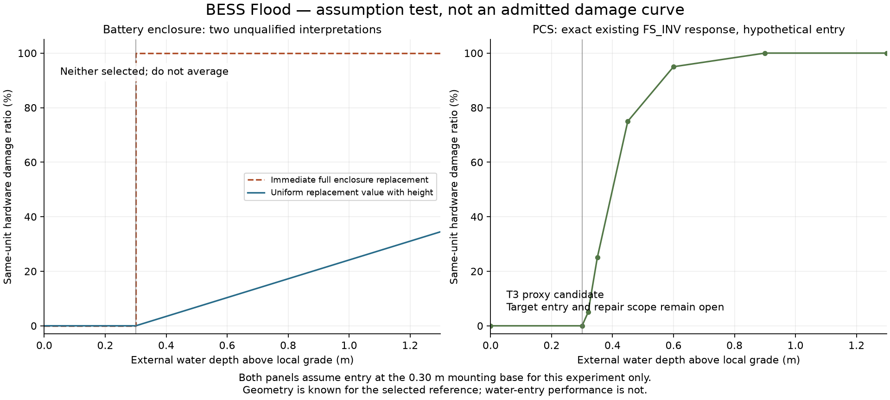

# BESS Flood: what the first candidate tests tell us

**Keep the PCS response as a conditional reuse candidate. For the battery,
resolve the repair unit before selecting a depth–damage curve.** We now have
manufacturer anatomy, observed immersion evidence and a reproducible comparison
of two tempting enclosure interpretations. Neither interpretation is a
qualified expected-loss curve. This is a completed candidate pressure test, not
completion of the BESS Flood model.

The prior [evidence review](01_flood_evidence_and_reuse.md) pins the asset and
budget. This pass changes neither: 80 enclosures at $1.05M hardware each,
20 PCS groups at $520,000 each, and $15.4M of other physical value retained.

## 1. Four targeted primary-source checks

| Question | Evidence reviewed | Result and consequence |
|---|---|---|
| Is a container one unprotected battery volume? | Sungrow PowerTitan ST2752UX manual, printed pp8–13, 25–26, 35 and 42; BF-S09 | No. Racks, DC/DC, supply/control panels and cooling occupy distinct areas; the LFP modules have their own IP65 specification. This older, smaller separate-PCS architecture supports the anatomy, not our exact dimensions or flood resistance. Do not copy its rack count or assign an IP discount. |
| Does immersion without fire mean no damage? | NHTSA/Argonne DOT HS 813 136, printed pp15–17, 19–24 and 27; BF-S10 | No. Seven automotive packs were tested; water intrusion and degradation occurred, and two later produced smoke/venting. The heterogeneous tests do not estimate a BESS fire probability. Postmortem inspection followed additional immersion to discharge the packs, so it cannot establish a short-duration damage point. |
| Does an immersion standard supply a damage curve? | Sandia SAND2017-6925, printed p36, §4.4; BF-S11 | No. It specifies exposure and measurement procedures. It supplies neither observations nor repair costs. Use it to specify future evidence, not to fill curve ordinates. |
| Is generic inverter reuse physically plausible? | SMA storage/MV system manual, printed pp22, 267, 274–275; BF-S12 | Yes as a related-equipment proxy candidate. But the inverter has differently protected compartments, and the manual calls for inspection/rectification after flooding, not automatic replacement of every PCS part. No exact critical-entry elevation or replacement share is supplied for our reference. |

Exact source versions, URLs, locators and allowed inferences are in
[sources.csv](evidence/sources.csv). [The r2 capture receipt](evidence/r2/source_captures.json)
pins original PDF bytes. Critical diagrams/tables were rendered and visually
checked; downloaded source text and images remain in the ignored research cache.

## 2. Keep these three physical states separate

The evidence supports these mechanisms, but does not quantify every arrow.
The pack can have a protected case while connectors or controls are affected.
Damaged controls can stop the whole enclosure without destroying every cell.
Conversely, absence of flame does not mean the battery is reusable.

NEMA's battery-replacement guidance applies after establishing that the relevant
battery is water-damaged. It does not identify all $1.05M of our integrated
enclosure as one mandatory replacement. A flooded-module repair scope, supported
by a replacement procedure and cost split, could justify a grouped response
without modeling individual cells.

## 3. Actual hypothesis comparison

For this **experiment only**, assume water enters at the selected 0.30 m base.
That assumption remains unqualified; base height is not evidence of entry
height. Compare:

- **Immediate bundle replacement:** replace all enclosure hardware at any
  positive depth above the assumed entry. This tests the consequence of treating
  the enclosure as the indivisible loss unit.
- **Uniform-height replacement:** lose the fraction `(depth − 0.30) / 2.90`,
  limited to 0–1. This tests a tempting geometric shortcut; it assumes replacement
  value is uniform with height and that wetted portions fail independently.

Both are unselected, T4 interpretations. They are **not lower/upper confidence
bounds**, not a calibrated probability mixture, and not candidates to average.
The second is rejected as a selected mean unless a repair/value-height model
supports it. The first remains a stress interpretation until whole-unit
replacement and entry are justified.

| External water depth above local grade | Immediate bundle, one enclosure | Uniform-height shortcut, one enclosure | Existing PCS proxy, one separate PCS |
|---:|---:|---:|---:|
| 0.30 m | $0 | $0 | $0 |
| 0.32 m | $1,050,000 | $7,241 | $26,000 |
| 0.45 m | $1,050,000 | $54,310 | $390,000 |
| 0.60 m | $1,050,000 | $108,621 | $494,000 |
| 0.90 m | $1,050,000 | $217,241 | $520,000 |

All dollar entries are **audit arithmetic**, rounded to dollars, not predicted
site losses. PCS uses the same hypothetical 0.30 m critical entry. Its ordinate
comes from the unchanged `FS_INV` native-axis curve; the battery columns are
explicit assumption tests. Full precision and additional depths are in
[the saved tests](evidence/r2/README.md).

At 0.45 m, the two battery interpretations differ by about **19.3×**. That is a
material repair-unit decision, not an interpolation detail. Improving grid
resolution would not resolve it. The next investigation should address that
decision, rather than search for a more elaborate smooth function.

## 4. What is reusable for PCS, and what is still open?

**Carry forward the exact nine `FS_INV` knots as a T3 candidate for separate PCS
hardware.** No refit or new shape is justified by this pass. The source ordinates
are analyst engineering proxies supported by electrical damage mechanisms;
they are not measured SMA or Sungrow loss data.

| Binding item | Status |
|---|---|
| Function / equipment family | Related power-electronics proxy is plausible; bidirectional storage is not an automatic new Flood mechanism |
| Budget denominator | Separate $10.4M PCS hardware exists; $520k per identical reference group. Never include MV transformer or the battery enclosure in this denominator |
| Axis | `max(0, external_depth_above_local_grade − critical_entry_above_same_grade)`; use the critical entry once |
| Domain | 0–2 m above the source critical datum; outside this range the experiment returns no output |
| Entry elevation | Unresolved for the target; 0.30 m is an experiment assumption, not an adopted setting |
| Whole-group repair fraction | Generic T3 source proxy, not established by the OEM guide; needs explicit screening rationale before admission |
| Duration / salinity | No calibrated correction; freshwater scenario tested. Saline and unknown water are explicitly unsupported by this candidate audit |
| Enclosure rating | No numerical credit; a rating cannot select an economic curve on its own |

For two PCS units at depths 0.25 m and 0.45 m under the experiment assumption,
the arithmetic is `0 × $520k + 0.75 × $520k = $390k`. It is not
`0.75 × the entire $10.4M PCS fleet`. Repetition in an inventory does not erase
spatial support. At a uniform depth the corresponding sum is valid, but that
uniform exposure must be supplied by Hazard, not assumed by Damage.

The existing Pluvial cap and selected base are both 0.30 m. Consequently these
direct-overtopping assumptions produce zero throughout that capped demand
range. This is a limitation of this **particular mechanism/assumption pairing**,
not evidence of zero Flood risk. We have not modified the hazard or invented a
lower entry to create a nonzero result.

## 5. Validation and scope

The original seven-step audit still governs: asset, unit and endpoint scope
(steps 1–3) are explicit; the reference budget reconciles, but any finer repair
allocation remains open (steps 4–5); target water-entry qualification is open
(step 6); step 7 now has tested hypothesis arithmetic, not an admitted response.
No validation count closes those scientific questions by itself.

[The reference helper](../../../../scripts/reference_helpers/bess_flood_candidate_audit.py)
imports the existing source evaluator and reads pinned Hazard inputs. It tests
native knots, threshold equality, a once-only height shift, repeated units at
different depths, value conservation, missing/nonfinite/negative inputs,
units, salinity, incompatible value units, unsupported protection and out-of-domain
exposure. Results and exact hashes are in [the receipt](evidence/r2/audit_receipt.json).

These checks establish reproducible arithmetic and intended rejection behavior.
They do not validate the battery hypotheses, the target PCS entry or a complete
annual loss model. The experiment has no EAL/PML output and cannot be loaded
through the runtime index. No existing cell, hazard model or production API changed.

## 6. Next bounded step and future work

**Next: close one grouped repair model, then package the candidate.** Seek an
OEM/service rule distinguishing replacement of wet modules, shared control/power
assemblies and the enclosure shell, paired with a defensible cost allocation.
Use only groups that change the answer materially. If whole-enclosure replacement
is the practical policy, document that policy and its entry assumption explicitly
as a screening proxy; do not present it as measured average damage.

The [repair-unit matrix](evidence/r2/repair_unit_matrix.csv) records the exact
missing links and useful next evidence. A full cell-by-cell model, stochastic
seal-aging model or new hazard solver is outside this initial delivery.

| Topic | Current treatment | Evidence/test that would reopen it |
|---|---|---|
| Entry and bypass | No adopted critical datum; geometry kept separate | A section drawing or installation/service instruction locating vulnerable terminals/vents and conduit entry |
| Grouped repair value | Preserve $84M bundle, no invented subshares | Replacement scope plus costs for battery modules, control/cooling and reusable shell; reconcile to the existing budget |
| Thermal escalation | Possible external-hazard consequence; unquantified, no added charge | Matched externally initiated test/incident with spread and repair endpoint; count damaged hardware once |
| Salinity/duration | No multiplier | Comparable tests with controlled exposure and documented post-test treatment and repair assessment |
| Other sizes | Same-unit compatibility must precede scaling | The already tracked MW/MWh, duration, integer-unit and layout tests in Hazard's scaling handoff |

The updated skill now calls out post-test treatment and intervention censoring
when interpreting test evidence. That is a reusable research improvement;
it introduces no extra compulsory folder sequence or approval step.
