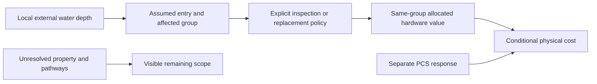

# BESS Flood: a costed, grouped candidate for review

**We can now allocate the enclosure budget from an inspectable cost source.
The remaining material choice is the repair policy after assumed water entry.**
I recommend testing a conservative **active-hardware replacement policy** for
the first screening model. That is a deliberate engineering scenario, not a
measured average damage curve. BF-Q01 below is open; neither this policy nor its
entry assumption is a runtime default.

The starting problem is one $1.05M enclosure: a wet battery may require
replacement, but that does not establish that every dollar of its container,
racks and safety equipment is destroyed. Conversely, counting only a geometric
slice of its height can miss shared controls and replacement dependencies.

## What changed since the preceding review

| Item | Previous checkpoint | This checkpoint |
|---|---|---|
| Enclosure value | $84M across 80 enclosures; internals unallocated | Four cost groups reconciled to the same $84M using the original PVSCM inputs |
| Conditional battery consequence | NEMA guidance and industrial emergency context | Additional LFP OEM guidance explicitly prohibits reuse of a flooded battery; still not a utility-enclosure depth curve |
| Entry / affected fraction | Unknown, tested with two incompatible hypotheses | Still unknown; an explicit conservative policy is costed below instead of disguising it as observed physics |
| Owner choices | Plant scope, design and screening purpose settled | One new choice about the meaning of the first response; existing scope unchanged |
| Runtime | No admitted BESS curve | Unchanged; 31 new research checks, no index or existing curve change |

## 1. Where the allocation comes from

The NREL report already used for our valuation, **NREL/TP-6A40-93281, printed
p18 Table 3**, describes the battery components and points back to PVSCM 2024.
The original [Q1-2024 model archive](https://data.nlr.gov/submissions/307)
contains `UPV 2024Q1.txt`, which supplies the actual cost inputs. BF-S13 and
BF-S14 record the source identity and exact locators. The workbook was inspected
read-only; no Excel macro was run and no cached workbook output was treated as a
calculated result.

The source's **“Battery Packs” row is management plus thermal equipment**, not
the entire electrochemical pack. Its cells are a separate row. Also, its
“Enclosure” row includes racks and fire suppression; calling it a purely passive
steel shell would be wrong.

| Cost group | Source direct input, $/kWh-cap | Share of those inputs | Allocated share of one $1.05M enclosure |
|---|---:|---:|---:|
| Cells | 96.30 | 68.15% | $715,605 |
| Battery management | 17.50 | 12.38% | $130,042 |
| Thermal management | 7.50 | 5.31% | $55,732 |
| Container, racks and fire-suppression composite | 20.00 | 14.15% | $148,620 |
| **Total** | **141.30** | **100%** | **$1,050,000** |

Displayed rows are rounded; exact values reconcile in
[the generated allocation table](evidence/r3/value_allocations.csv).
The source's cell input is `75 × (1 + 0.034 + 0.25) = 96.30`; management and
thermal inputs split its $25 row 70:30. These are the historical model's market
case inputs, **not a statement about today's tariffs**.

**Transfer assumption:** normalize those direct-input costs into dimensionless
shares, then allocate our existing enclosure budget proportionally. This spreads
the already included manufacturing, shipping and other embedded price amounts
in the same proportions. It is a T3 related-benchmark allocation, not a bill of
replacement parts or a new appraisal. Field repair labor remains outside these
hardware amounts and must be allocated once later.

The donor file labels its dollars 2023 USD and describes a PV-associated ESS;
our fixed budget is 2024 USD for the selected standalone plant. We transfer
**shares only**, never multiply the donor $/kWh-cap rates by our usable AC energy
or add them to the $84M. Its descriptive 3 MWh / 1 MW cabinet and four-hour
duration factor are inconsistent; neither defines our geometry or ratings.

As a sensitivity, using the donor's undistorted direct inputs changes the
active-hardware share from **85.85% to 83.33%**. The resulting whole-group
replacement amount is **$901,380 versus $875,000 per enclosure**. This is a
cost-allocation sensitivity, not statistical uncertainty. The water-entry and
affected-unit assumptions have a much larger potential effect.

## 2. What the repair evidence establishes

The [Sungrow SBS050 manual](https://uk.sungrowpower.com/upload/file/20250603/EN_UM_SBS050_User_Manual.pdf),
revision `SBS050-UEN-Ver13-202504`, printed p6 §§1.3.3–1.3.4, says a flooded
battery must not be reused. BF-S15 is **adjacent residential LFP evidence**; it
does not establish the entry height, internal spread or service policy of our
utility enclosure. Combined with BF-S02 and the utility anatomy in BF-S09, it
supports the distinction between an affected battery assembly and surrounding
equipment. It does not authorize cell-level field repair.

We have still not recovered a matched service rule specifying how many utility
modules are replaced at each external water depth. The exact limits and failed
retrievals are in [the bounded search record](02_bounded_search.md).

Cost allocation closes the right-hand value question. It does **not** close the
left-hand exposure question. Unknown affected fraction continues to return no
cost in the audit helper; it never silently becomes 100%.

## 3. BF-Q01 — use a conservative common-entry policy for the first candidate?

**In plain words:** should we deliberately model an enclosure's active hardware
as a replacement group once floodwater exceeds its assumed entry level, while
showing that this is a conservative screening assumption?

The proposed rule for this first candidate is:

1. Keep the selected 0.30 m mounting height. Explicitly assume the same elevation
   as the common entry level for this policy; do not claim an OEM ingress rating.
2. At or below that level, the direct-entry pathway contributes zero. This does
   not represent splash, groundwater/conduit bypass, other flood mechanisms or
   proof of safety.
3. Above it, assume the whole battery, management and cooling group requires
   replacement: about **$901,380 per affected enclosure**, not $1.05M. Replacing
   all cooling equipment is part of this conservative policy, not an OEM mandate.
4. Keep the container/racks/fire-suppression composite outside this first
   response until its own treatment is resolved. It is **unmodeled, not immune**.
   Treat separate PCS at its own location and value through its own qualified
   response. Never charge the same enclosure twice for flood and resulting
   internal damage already included in this replacement group.

This deliberately does not simulate the sequence of water movement through
individual modules. Shared control dependencies and post-flood return-to-service
uncertainty motivate the conservative group; they do not prove all cells are
physically destroyed at the first millimeter of entry.

| Example: one enclosure, external depth 0.45 m | Explicit policy cost |
|---|---:|
| Entry assumed at 0.30 m; replace battery/management only | $845,648 |
| Entry assumed at 0.30 m; replace all active hardware — proposed | $901,380 |
| Entry assumed at 0.30 m; replace entire integrated enclosure — stress comparison | $1,050,000 |
| Entry assumed at 0.60 m; proposed direct-entry group | $0 for this pathway |

These are alternatives, **not a confidence interval or upper/lower bound on
real loss**. The 0.60 m entry is a sensitivity fixture, not a revised asset or a
qualified resilience measure. All numbers are generated by
[the value audit](../../../../scripts/reference_helpers/bess_flood_value_audit.py).

**Options**

- **A — Use this conservative group as the next screening candidate
  (recommended).** It gives a simple, transparent response to qualify and test
  locally, and retains a clear replacement path when matched data arrives.
  The tradeoff is potentially high loss immediately above assumed entry. It
  cannot be labeled a measured average, an insurance estimate or a complete
  Flood result.
- **B — Require a depth-to-affected-module/service relationship before selecting
  the battery response.** Continue separate PCS and other qualified equipment,
  but hold the battery result. This preserves a more specific physical claim
  and makes the battery timeline dependent on obtaining that evidence.

**Recommendation:** A for the next candidate/local proof, with its T4 entry and
replacement policy visible. We have enough evidence to price and describe the
assumption honestly, but not enough to present it as calibrated expected damage.
This is not a request to revisit the agreed plant boundary or rebuild Flood.

**If chosen:** Damage packages the proposed group and PCS with explicit
capabilities, tiers, domains and tests. Hazard binds each unit once and evaluates
the existing flood demand. No database, live dashboard, existing cell or CONUS
publication changes at this decision. Downstream EAL/tail admission remains a
separate check: a policy scenario's annualized result retains that meaning.

**Ruling:** ______

The [discussion skill](/Users/divy/.agents/skills/discuss-open-questions/SKILL.md)
says, “Do not implement a choice that depends on an open ruling.” This applies
only to adopting BF-Q01's new repair policy; source allocation, auditing,
documentation and independent equipment research can proceed. The skill does
not require another general research authorization.

## 4. What this does and does not cover

The proposed active hardware represents **$72.11M**. Adding the existing separate
PCS candidate's **$10.4M** would address **75.15% of the $109.8M reference value**,
if both are admitted. That is potential value coverage, not a measured loss
fraction. The other **$27.29M** remains visible: $11.89M in the enclosure composite
plus $15.4M of other plant property/work. Do not renormalize these groups to 100%
or label a subtotal complete plant loss.

The existing Pluvial cap is 0.30 m. Under the proposed 0.30 m direct-entry
policy it produces zero from this battery pathway. Riverine and Coastal have
different demands, but Coastal salinity and other transfer conditions still need
qualification. Raising the modeled water or lowering the equipment simply to
produce a colored map would be wrong.

Current proof: **31 checks pass**, covering source inputs, unchanged reference
totals, both allocations, explicit/unknown affected fractions, repeated units
and entry boundaries. Original source bytes, helper and outputs are pinned in
[the r3 audit](evidence/r3/README.md). No numerical model version changed.

Next after the ruling: finish the proposed cell's capability/value matrix and
the remaining-property dispositions, then prove one local Hazard path. Future
improvements retain exact triggers: matched ingress tests; module-level repair
and labor quotes; salinity/duration; fire-system cost split; and duration/size
scaling. These are not a new open-ended literature assignment.
