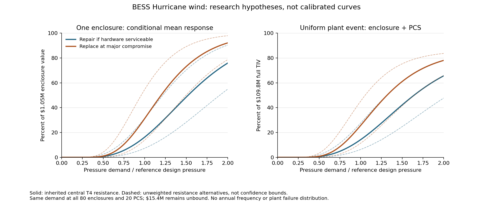

# Hurricane enclosure and PCS: costed candidates

**Starting problem:** one enclosure is worth $1.05M, but major wind damage does
not tell us whether its battery hardware is reusable. The same cost allocation
gives a **$204,352 repair hypothesis versus $1.05M integrated replacement**.
We have now calculated both policies, kept the same inherited synthetic wind
response, and recorded the owner's local-test selection below. Neither policy is a measured mean or
an admitted runtime model.

Iteration 1, 2026-10-19. Change class `EVIDENCE_ONLY_NO_OUTPUT_CHANGE`;
`inside_repo`. These are research hypotheses, not a new canonical cell, release
candidate or approved annual consumer. Current artifacts, index, schemas and
versions remain unchanged. The [first seven-step audit](06_hurricane_wind_intake.md)
still governs the reference. This pass advances its response, value allocation
and repair-state questions; national wind-reference and annual qualification
remain later finite engineering checks.

## What changed

| Before | Now |
|---|---|
| Sources identified the missing enclosure repair link | Actual mechanical-damage guidance and explicit project wind-design criteria inspected |
| Existing electrical curves reproduced only | Their synthetic state probabilities are reused in an explicitly labeled target research comparison |
| Cabinet budget did not price wind states | Existing cost groups now price two coherent hypotheses on the same $1.05M denominator |
| Broad next research task | 486 candidate rows, 243 source-parity checks, ten axis controls and one consequential local-test choice |

The additional [sources](evidence/hurricane/r2/sources.csv),
[claims](evidence/hurricane/r2/claims.csv),
[parameters](evidence/hurricane/r2/parameter_register.csv) and
[exact input receipt](evidence/hurricane/r2/audit_receipt.json) extend the prior
registers; they do not replace their records or overwrite Flood policy approvals.

## 1. Physical and value reasoning

The Tesla industrial ERG says mechanical damage can create coolant/electrolyte
leaks and internal thermal hazards; it calls for evaluation of damaged products.
It does **not** say every dent requires replacement of an entire enclosure.
That supports an explicit repair decision, not a numeric wind fragility or
propagation probability (BW-C10; printed pp13/20, rendered PDFpp15/22).

A public Tesla project drawing specifies ultimate wind speed, exposure and risk
category, rather than a bare survival label (BW-C09; S-101/PDFp29). This is
site-specific construction evidence. Its 105 mph and hospital Risk Category IV
are not transferred to our canonical BESS. The earlier adjacent 66 m/s supplier
label remains unusable as a matched gust-resistance parameter.

Retain the source-native **container/racks/fire-suppression composite**. It is
14.15% of the existing cabinet budget, not a measured steel-shell cost. Together
with thermal management it is 19.46%. These related-benchmark allocations price
a repair hypothesis; they do not prove that its battery and management hardware
can be reused after structural compromise.

| State in the comparison | Repair if hardware serviceable | Replace at major compromise |
|---|---:|---:|
| No direct repair | $0 | $0 |
| Limited damage assigned to enclosure/rack/safety composite | $148,620 | $148,620 |
| Major integrity compromise | $204,352: composite + thermal; battery/BMS assumed reusable | $1,050,000: integrated unit replacement |
| Destructive unit damage | $1,050,000 | $1,050,000 |

The limited-state amount is itself a T4 whole-composite repair/replacement
assumption; it is not a cosmetic-dent quote. Charging the entire composite can
overstate a smaller repair. The destructive state defines integrated unit
replacement once; it does not claim every cell is destroyed or add a second fire
loss. Removal, disposal, BI and residual on-site labor are not silently added.
Using the older undistorted cost allocation changes the major-repair example to
$240,625, still far below the integrated $1.05M replacement. That is a cost-basis
sensitivity, not a confidence interval or evidence of serviceability.

## 2. What generates the curves—and what does not

For research only, transfer the existing **T4 synthetic** electrical-equipment
state-probability skeleton from `TCWS21_POWER_COLLECTION_SCREENING_T4_ORDERED_STATES`.
Central pressure-ratio medians are 0.90/1.25/1.65 with log dispersion 0.35.
The source's lower/upper resistance alternatives scale those pressure medians
by 0.8/1.25. All remain expert assumptions; the transfer to enclosure construction
is another T4 assumption. No BESS failure data were fitted. Sharing the skeleton
isolates repair-policy sensitivity; it does not demonstrate identical physical
fragility of a battery enclosure and PCS.

```text
comparable event/reference wind -> squared pressure ratio x
    -> inherited synthetic exact-state probabilities
    -> explicit cabinet or PCS cost for each state
    -> conditional mean same-unit cost
```

The same-unit conditional DR is `sum(state_probability × state_cost_fraction)`.
Fragility and economic consequence remain separate. The research experiment
does not draw random failure states across 80 enclosures, assume independent
failures, construct a plant distribution or annualize loss.

The candidate PCS transfer retains the source's 0/10/40/100% state costs and
applies only to **$520,000 per separate PCS**, with explicit target-transfer
qualification still needed. No Solar MW, collection dollars or Substation
assembly DR is substituted. The target enclosure means are separately recosted.



The two solid lines differ only in repair policy. Dashed lines vary inherited
resistance and are unweighted alternatives, **not confidence bounds**. The
right panel is a uniform-event fixture at every enclosure and PCS, not a map,
event footprint prediction, PML or annual probability. It demonstrates
materiality and the limits of interpreting one candidate curve as calibrated.

At event gust equal to the illustrative reference gust (`x=1`), using the
inherited central skeleton:

| Research example | Repair if hardware serviceable | Replace at major compromise |
|---|---:|---:|
| Mean one-enclosure cost across synthetic states | $170,965 | $327,948 |
| Same demand at all 80 enclosures + 20 PCS | $15.613M | $28.172M |
| Uniform-event cost / full $109.8M TIV | 14.22% | 25.66% |

These are outputs of hypotheses, not evidence that a design-level storm
typically causes those losses. The probabilities, transfer, reference and repair
policy all remain weakly supported. There is no general upper/lower bound on
real loss. `x=1` is not a deterministic failure threshold or a regulatory code
performance assertion.

## 3. BW-Q01 — major structural compromise — ruled for local testing

**In plain words:** for the first local wind test, should major compromise of an
enclosure trigger integrated replacement, or should we assume its batteries and
management hardware can be inspected and reused?

**Example:** one affected enclosure costs $1.05M before the event. The repair
hypothesis prices its composite and cooling at $204,352; integrated replacement
costs $1.05M. Both retain the same cabinet budget and wind-response skeleton.
Ordinary superficial damage is not automatically classified as major compromise.

**Options**

- **A — Integrated replacement after major compromise (recommended for local
  testing).** Conservative return-to-service policy without assuming undocumented
  internal serviceability. It may materially overstate repairable damage. The
  OEM source motivates caution but does not mandate this universal outcome.
- **B — Repair composite/cooling and reuse serviceable battery/BMS hardware.**
  Lower conditional cost; requires the additional optimistic serviceability
  assumption for this state. Keep it as the alternative, rather than averaging
  the policies into an unsupported central estimate.

**Recommendation:** A as a labeled local-test hypothesis, with B retained as
the cost-policy sensitivity and all resistance assumptions visible. This advances
a practical proof while preserving the exact evidence needed to refine it.

**If chosen:** package the proposed enclosure/PCS candidate with explicit source
pins, tiers, domains, property membership and local-only capability. Qualify the
BESS wind-reference/demand bridge and local source cases using existing Hurricane
M0/M1. Canonical Damage release, annual EAL/tail admission and national execution
remain separate proofs. Flood, existing Solar/Wind/Substation outputs and the
live dashboard are unaffected.

**Ruling — owner, 2026-10-19:** “Test full replacement; retain repair as a
sensitivity (Recommended)”.

This selects A for local testing, with B retained as a sensitivity. It does not
assert measured damage, approve a national wind-reference policy or qualify
annual risk. Proceed with the exact proposed candidate and local conditional
verification; no repeated confirmation of this policy is needed.

## 4. Bounded next checks and future work

- **Wind reference:** select an explicit BESS screening reference before
  geographic losses. Existing ASCE data include MRI300/700/1700/3000, so copying
  the station's MRI300 is not forced by data availability. This experiment leaves
  that choice unset. Its 60 m/s examples are fixtures, not a national capacity.
  Comparable three-second/height/exposure semantics and no extra shelter credit
  remain required; out-of-domain demand stays unavailable, never clamped.
- **Local binding:** test the selected repair policy, unit quantities, resistance
  scenarios, missing inputs, wrong basis, source-domain tails and value caps.
  Preserve the source's unknown-duration/direction flags and transfer limitations.
- **Partial scope:** possible enclosure/PCS membership is **$94.4M / 85.97%**
  of full TIV. Unit-MV/shared electrical, civil and on-site fieldwork total
  **$15.4M**, still without a wind response. Do not renormalize or declare them safe.
- **Refinement trigger:** matched enclosure/anchor tests or inspected wind repair
  outcomes reopen the probability model; OEM service rules/BOM reopen repair
  states; component values reopen residual property. Debris, rain ingress and
  triggered propagation remain separately scoped mechanisms with no invented
  annual rates or protection credit.

The [saved experiment](evidence/hurricane/r2/README.md) passes 486 candidate-row
checks, 243 independent source-parity comparisons, ten axis controls and six
monotonicity checks. All source/current artifacts remain unchanged. These checks
establish implementation consistency of the hypotheses, not target calibration.

## 5. Selected proposal packaged and checked

After the owner's BW-Q01 response, the
[proposed v0.1 package](../../../cells/tropical_cyclone_wind_bess/proposed/local_candidate_v0_1/README.md)
now contains three numerical records: approved enclosure replacement, retained
enclosure repair sensitivity and the PCS proxy. Existing bundle/capability v3
schemas pass. The package preserves all ten value rows, 13 source records and
16 claims, including the owner ruling.

The [conditional validation](../../../cells/tropical_cyclone_wind_bess/proposed/local_candidate_v0_1/validation.json)
passes 972 comparisons against the independent research expectations, 14 negative
response controls, one explicit-opt-in control and three tampered-payload
controls. A local reader verifies artifact/value/capability and numerical-helper
hashes. Unsupported demand/property returns no cost; complete-plant loss stays
null. The package is `NEW_CELL_SCAFFOLD` with a selected local-test candidate,
not a canonical release or a new runtime-index entry. Annual metrics remain
withheld. Next is the bounded Hazard reference/exposure coupling proof.
