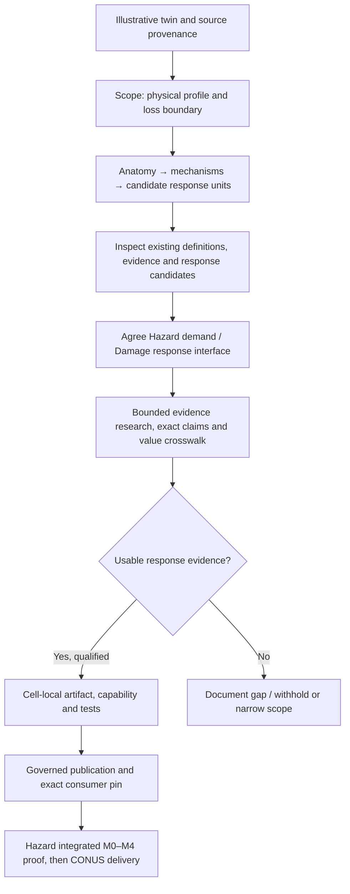

# Damage flow, reusable inventory and the Real Estate extension

**Checkpoint note:** this node records the initial method review and skill change, before branch intake.
The subsequent [Junga research review](03_junga_research_intake_and_next_work.md) imports a noncanonical
Flood proposal, checks an office source and tests the Hazard consumer. Follow it for current next work;
the no-cell-change statements below describe this earlier foundation phase.

## Finding and resulting action

The repository already has substantial governance for failure units, pathways, exact artifact pins,
capabilities and value accounting. It also has an explicit shared-component standard and worked reuse
inventories. The review supports extending those mechanisms rather than creating another component library.
It does **not** establish that an arbitrary building profile can run through the present evaluators.

The immediate improvement is to connect an illustrative twin to a realistic research scope before naming
cells or fitting curves, and make the whole flow visible. The local skill revision 0.7 adds that entry
point, reuse qualification and asset-appropriate value units. No numerical cell or runtime schema changes.

Shared direction and product choices live in the
[Hazard plan](../../../../Hazard_modeling/docs/plans/_cross_cutting/real_estate_conus/README.md).
The owner accepted warehouse, detached house, a three-story office candidate and building physical loss
first. Exact construction, dimensions, condition and elevations still require review. The original twin's
retail scene remains a reference, not evidence of the newly selected office profile.

## What was inspected

| Surface | Observed support | Limit or implication |
|---|---|---|
| [Shared-component standard](../../../method/standards/20_shared_component_substrate_standard.md) | Separates equipment × mechanism × compatible construction from cell-local exposure, value and capability; defines promotion tests | Shared runtime reuse requires a separate contract change and at least two proven compatible cells |
| [Flood-electrical inventory](../../../method/shared_components/flood_electrical/README.md) and its catalog/binding rules | Reuses definitions, axes and evidence across Solar/Wind; preserves a source-native substation assembly | Catalog is non-runtime; a whole-substation source is not a collection of component curves |
| [Normalized-response comparison](../../../method/shared_components/solar_wind_normalized_response/README.md) | Pins a candidate comparison profile; checks equality to independently adopted cell-local parameters | Explicitly Solar-specific, Tier 4 and not a shared runtime dependency |
| [Bundle v3](../../../contracts/schemas/curve_artifact_bundle.v3.schema.json) and [standard 22](../../../contracts/standards/22_pathway_aware_artifact_and_emit_standard.md) | Pathways, failure units, curve records, exposure, value and capability contracts | Schema expressiveness does not prove a building evaluator or selector mapping exists |
| [Reference evaluator](../../../../scripts/reference_helpers/pathway_damage_curve_eval.py) | Pin checks, pathway identity and explicit failure-unit outputs | This helper declares a specific turbine archetype and two pathways; its generic-looking filename is not a universal evaluator |
| [Physical assembly schema](../../../contracts/schemas/physical_damage_assembly.v1.schema.json) | Explicit value/coverage/support composition for its implemented use | Requires `array_architecture`, `USD_per_kWdc`, capacity and Solar-specific output fields; it is not a building assembly contract |
| [Asset→artifact standard](../../../contracts/standards/24_asset_to_artifact_mapping_standard.md) | Exact equipment mapping, selector rules and basis/scope checks | Observed-asset routing is a useful precedent; it does not itself supply building codes or CONUS profile selection |
| [Machine index](../../../contracts/machine_readable_artifact_index.json) versus [human overview](../../../contracts/MACHINE_READABLE_ARTIFACTS.md) | JSON inspection lists nine cells at repository revision `2026-08-30.hurricane-solar-screening-v2-1-docs-r2-v3` | Overview still names an August 9 revision and lists eight; use exact current JSON pins and release receipts, not overview age, to infer availability |

This is a scoped implementation/documentation inspection, not a complete numerical audit of all nine cells
or a fresh verification of their remote publication. The front-door mismatch is recorded as documentation
debt; this change preserves runtime/contract files and does not launch a repository-wide cleanup.

## The flow a researcher should follow

1. **Orient and classify.** Read the relevant current index/cell/contracts, choose `inside_repo` or
   `outside_package`, and classify the actual change. This phase is documentation plus `SKILL_REVISION`;
   a later cell scaffold/release is a separate event.
2. **Intake and reduce.** Use the new
   [intake guide](../../damage_curve_skill/02_design_guides/ILLUSTRATIVE_ASSET_INTAKE_AND_REUSE.md)
   and [worksheet](../../damage_curve_skill/templates/TEMPLATE_ASSET_INTAKE_AND_REUSE.md). Keep the
   idealistic tree and selected scientific response grain distinct.
3. **Look for reuse before new derivation.** Inspect existing component definitions and exact response
   records. Record the permitted reuse level and test the full compatibility key. Shared names do not
   establish numeric equivalence; a mismatch can still permit source or vocabulary reuse.
4. **Choose the cell/release boundary.** Follow the
   [new-cell workflow](../../damage_curve_skill/01_workflows/ADD_NEW_CELL_WORKFLOW.md) only after the
   asset/mechanism scope is clear. Categories do not force three separate cells, and reuse does not force
   one universal cell. Keep pathway, selectors, event state and exposure distinct.
5. **Research and reconcile.** Use source/claim registers, exact locators, endpoint checks and bounded
   negative-search logs. Complete the seven-step audit and row-level value crosswalk. Attach every
   material value once, retaining unsupported value explicitly.
6. **Derive and test, or withhold.** Create a qualified cell artifact and known-answer tests, or preserve
   a no-curve scaffold. Test matching and mismatching bindings, source boundaries, overlap and missing
   inputs. A smooth curve is not a required research outcome.
7. **Promote and integrate.** Follow publication/capability contracts, preserve exact pins, and prove the
   Hazard consumer. Hazard owns occurrence, coupling and annual composition; Damage owns the admitted
   vulnerability response. Two complete research documents are not an integrated scientific result.

For outside-package work, source-drop intake precedes promotion to canonical folders. For ordinary work
inside this repo, edit those folders directly; no ZIP round-trip is required. The existing
[usage guide](../../guides/damage_curve_skill_usage_guide.md) remains the operational entry.

## First application to the selected candidates

These are research dispositions, not qualified curves or production component IDs.

| Candidate/node | Research question | Reuse or simplification test | What remains unresolved |
|---|---|---|---|
| Warehouse roof | Which cover/deck/connection assembly and failure endpoint are modeled for each peril? | Reuse assembly evidence only when construction and demand qualify; do not split cover/deck solely because the twin shows both | Structure, roof specification, age and repair scope |
| Warehouse fixed electrical services | Which equipment is included, where is its vulnerable datum, and what flood mechanism applies? | Inspect electrical definitions/evidence; do not import Solar/Wind equipment parameters or value shares by name | Equipment class, elevation, enclosure and same-unit repair value |
| Three-story office floors/interiors | How do local flood contact and repair scope relate to floor-specific values? | Preserve the source's building/assembly grain; prevent addition of already-included interior costs | Floor heights, lowest occupied floor, basement, source-compatible occupancy and denominator |
| Office roof/façade/fixed services | Which attributes differ enough to need separate response or exposure treatment? | Compare against the warehouse only after explicit construction/axis/endpoint checks | Frame, roof, façade/openings and fixed-service layout; office is not supplied by the retail twin |
| Detached house envelope/foundation | Which construction, roof and foundation assumptions define the reference? | House-specific or compatible assembly evidence; household contents and loss of use are excluded from this scope | Exact structure/roof/foundation, condition and physical value source |

Across all three, money is a physical repair/replacement budget with a price basis and scope. Floor area,
roof area, façade area, item count and total budget are different quantities. Neither market value nor the
twin's insurance limits become repair value by renaming them.

## Changes implemented in the skill

- Added a conditional step-zero intake/reuse guide and a compact worksheet; routed from the entrypoint,
  new-cell workflow, design-guide index and operator usage guide.
- Linked the existing shared-component standard; no duplicate registry or required new runtime fields.
- Generalized value-crosswalk prompts to amount/share/area/count/capacity as appropriate, retaining the
  existing CSV column names and Solar/Wind units.
- Recorded skill revision 0.7 independently of package/model/docs/schema versions. Bundle manifest and
  validation report track the changed skill files.

## Validation and remaining work

The skill's [validation report](../../damage_curve_skill/VALIDATION_REPORT.md) records structure,
classification self-tests and manual scenario review. The shared
[plan](../../../../Hazard_modeling/docs/plans/_cross_cutting/real_estate_conus/README.md) records
documentation checks and runtime-byte preservation. These checks do not establish numerical building
support; no new response is admitted here.

The next substantive work is to specify the selected profiles and perform a bounded peril × profile
feasibility review. Let actual evidence and two concrete compatible bindings determine whether cell-local
materialization is enough or shared runtime machinery is necessary. Building-unit assembly and CONUS
profile-selection changes belong to that implementation plan, with consumer tests and version decisions.

The proportional response to repository maturity is to make the path observable and exercise it on the
next asset. A large framework rewrite before the first qualified building response would not supply that
proof. This node remains active through the first real research application and its resulting lessons.
